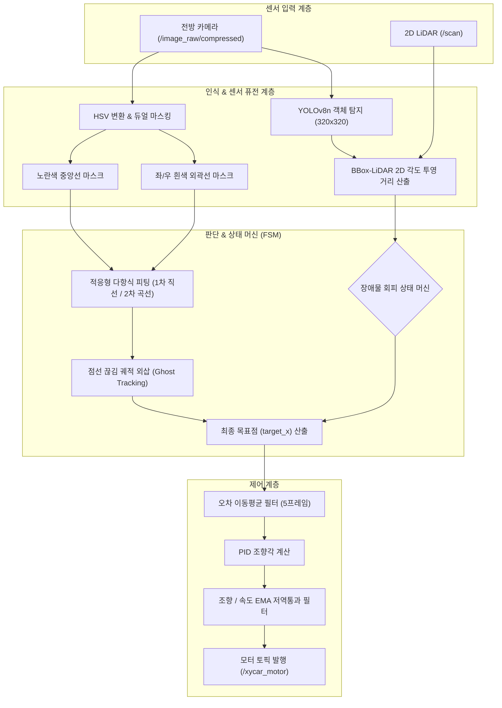

# 🚗 `Lane_follow.py` 자율주행 및 장애물 회피 시스템 인수인계 가이드

본 문서는 `kobot_vehicle` 패키지의 **`Lane_follow.py` (통합 자율주행 노드)**의 전체 시스템 아키텍처, 핵심 알고리즘, 파라미터 튜닝 방법 및 유지보수 가이드를 정리한 기술 문서입니다.

---

## 1. 시스템 개요 (System Overview)

`Lane_follow.py`는 **ROS 2 Humble** 환경에서 구동되는 메인 주행 제어 노드(`TrackDriveNode`)입니다.  
**전방 단안 카메라(OpenCV), 2D LiDAR(LaserScan), 온디바이스 YOLOv8n 신경망**을 상호 융합하여 다음 3가지 핵심 미션을 자율적으로 수행합니다:

1. **차선 인식 및 추종**: 노란색 중앙선(모노레일) 최우선 추종 + 노란선 소실 시 좌/우 흰색 차선 자동 Fallback 추종
2. **동적/정적 장애물 인지**: YOLOv8n 딥러닝 객체 검출과 2D LiDAR 거리 퓨전을 통한 실시간 장애물 위치(좌/우) 및 최단 거리(m) 산출
3. **정적 장애물 자율 회피 (FSM)**: 장애물 발견 시 반대편 흰색 차선으로 우회 주행 후, 장애물 통과 시 노란색 중앙선 자동 복귀

---

## 2. 시스템 아키텍처 및 데이터 흐름



---

## 3. 핵심 모듈별 상세 기술 설명

### 3.1 듀얼 HSV 마스킹 및 실시간 트랙바 (Perception)
- **노란색 차선 (1순위 주행선)**: 도로 중앙선(실선 또는 점선)을 추출합니다.
- **흰색 차선 (Fallback & 우회선)**: 도로의 좌측 및 우측 경계선을 개별 추출합니다.
- **X11 데드락 방지 단일 스레드 구조**: 메인 스레드(`rclpy.spin`)에서 OpenCV 이벤트 루프를 처리하여 GUI 프리징(Freeze)을 원천 차단했습니다.
- **실시간 GUI 트랙바 (`Trackbars`)**:
  - `Y_H_MIN ~ Y_V_MAX` (6개): 노란색 HSV 조절
  - `W_H_MIN ~ W_V_MAX` (6개): 흰색 HSV 조절

### 3.2 적응형 다항식 피팅 및 궤적 외삽 (Lane Modeling)
- **적응형 슬라이딩 윈도우 (Adaptive Polynomial Fitting)**:
  - 검출된 픽셀 수가 충분한 경우($N \ge 60$): **2차 다항식 곡선($x = ay^2 + by + c$)**으로 코너 곡률 추종
  - 픽셀 수가 적거나 직선/점선 구간: 과적합(Overfitting)을 방지하기 위해 **1차 직선($x = by + c$)**으로 자동 강등 피팅
  - 비정상 급곡률($|a| > 0.005$) 감지 시 직선으로 되돌리는 안전장치 적용
- **점선 끊김 궤적 외삽 (Ghost Extrapolation)**:
  - 차선이 순간적으로 끊기면 최근 10프레임의 `target_x` 이동 벡터를 외삽하여 최대 20프레임 동안 차선 방향을 유지합니다.

### 3.3 우선순위 기반 차선 추종 논리 (Priority Logic)
`STATE_NORMAL` 주행 모드에서 목표점(`target_x`)을 결정하는 우선순위는 다음과 같습니다:

1. **1순위 (최우선)**: **노란색 중앙선 단일 추종** (`yellow_target_x`)
2. **2순위 (노란선 소실 시 Fallback)**:
   - 양쪽 흰색 차선 모두 감지: $\text{target\_x} = \frac{\text{white\_left} + \text{white\_right}}{2}$ (도로 정중앙)
   - 좌측 흰색 차선만 감지: $\text{target\_x} = \text{white\_left} + 180\text{px}$ (차로 반폭만큼 우측 보정)
   - 우측 흰색 차선만 감지: $\text{target\_x} = \text{white\_right} - 180\text{px}$ (차로 반폭만큼 좌측 보정)
3. **3순위 (모든 차선 상실)**: 궤적 외삽 버퍼 예측 주행 후 모터 정지 (`LANE LOST`)

### 3.4 YOLOv8 + 2D LiDAR 센서 퓨전 (Sensor Fusion)
- **주기적 GPU 추론**: 제어 루프의 실시간성(30FPS) 보장을 위해 3프레임당 1회 `imgsz=320` 초경량 추론 수행
- **카메라-LiDAR 2D 각도 투영**:
  - 카메라 수평 화각($\text{FOV} = 68.0^\circ$)을 기준으로 바운딩 박스의 좌우 픽셀 범위($x_1, x_2$)를 LiDAR 각도 범위로 변환합니다.
  - 해당 각도 구간 내의 유효 라이다 거리 데이터 중 상위 10% 최솟값(10th percentile)을 추출하여 노이즈 없는 정확한 장애물 거리($m$)와 위치(`LEFT`/`RIGHT`)를 결정합니다.

### 3.5 정적 장애물 회피 상태 머신 (FSM)
- **`STATE_NORMAL`**: 노란색 중앙선을 따라 기본 속도(`30.0`)로 안정 주행
- **`STATE_AVOID_LEFT`** (좌측 장애물 $1.3\text{m}$ 이내 감지):
  - 우측 흰색 차선(`white_right_x - 180px`)을 기준으로 우회 주행, 안전 속도(`20.0`)로 감속
- **`STATE_AVOID_RIGHT`** (우측 장애물 $1.3\text{m}$ 이내 감지):
  - 좌측 흰색 차선(`white_left_x + 180px`)을 기준으로 우회 주행, 안전 속도(`20.0`)로 감속
- **`STATE_RETURNING`**: 장애물이 $1.8\text{m}$ 이상 멀어지거나 소실되면 25프레임 동안 회피 경로 유지 후, 노란색 중앙선 재인식 시 `STATE_NORMAL`로 자동 복귀

### 3.6 PID 제어 및 속도/조향 평활화 (Control & Smoothing)
- **오차 계산**: 화면 중심($x=320$)과 목표점($\text{target\_x}$) 간의 편차
- **Error 이동평균 필터 (Window=5)**: 점선 깜빡임에 의한 순간 조향 튐 방지
- **조향각 EMA 필터 ($\alpha = 0.4$)**: 부드러운 핸들링 제공 및 VESC 과부하 방지
- **속도 EMA 필터 ($\alpha = 0.1$)**: 조향각에 따른 연속 비례 감속 및 직선 복귀 시 부드러운 가속 (울컥거림 제거)

---

## 4. 핵심 파라미터 설정 및 튜닝 가이드

모든 주행 상수는 `Lane_follow.py` 내부의 `Config` 클래스 및 ROS 2 파라미터에 정의되어 있습니다:

| 파라미터 | 기본값 | 설명 |
| :--- | :---: | :--- |
| `h_low / h_high` | `39 ~ 93` | 노란색 차선 Hue 임계값 (실측 튜닝값) |
| `s_low / s_high` | `0 ~ 255` | 노란색 차선 Saturation 임계값 |
| `v_low / v_high` | `34 ~ 255` | 노란색 차선 Value(명도) 임계값 |
| `w_h_low / w_h_high` | `85 ~ 180` | 흰색 차선 Hue 임계값 (실측 튜닝값) |
| `w_s_low / w_s_high` | `115 ~ 255` | 흰색 차선 Saturation 임계값 |
| `w_v_low / w_v_high` | `75 ~ 255` | 흰색 차선 Value(명도) 임계값 |
| `OBSTACLE_AVOID_DIST` | `1.30 m` | 정적 장애물 회피 진입 거리 |
| `OBSTACLE_CLEAR_DIST` | `1.80 m` | 장애물 통과 판정 거리 |
| `WHITE_LANE_HALF_WIDTH` | `180 px` | 단일 흰색 차선 추종 시 가상 중앙선 오프셋 |
| `BASE_SPEED` | `30.0` | 일반 직선 주행 기준 속도 |
| `AVOID_SPEED` | `20.0` | 회피 주행 중 안전 제한 속도 |
| `Kp / Ki / Kd` | `0.15 / 0.0 / 0.05` | PID 조향 제어 게인 |

---

## 5. 실행 및 디버깅 방법

### 5.1 패키지 빌드
```bash
cd ~/2026_Xytron/real/ros2_ws
colcon build --symlink-install --packages-select kobot_vehicle
source install/setup.bash
```

### 5.2 노드 실행
```bash
ros2 run kobot_vehicle lane_follow
```

### 5.3 디버그 GUI 화면 해석
- **`Lane_Control (Cropped)`**:
  - 🟡 **노란 곡선**: 피팅된 주행 궤적 다항식
  - 🟣 **분홍색 점 & 흰색 선**: 룩어헤드 목표점(`target_x`) 및 조향 편차
  - 🔴/🟡 **사각형 박스**: 탐지된 장애물 Bounding Box 및 LiDAR 거리/방향 텍스트
  - 🟢 **초록색 박스**: 슬라이딩 윈도우 탐색 영역
- **`Yellow_Mask` / `White_Mask`**: 노란색 및 흰색 이진화 마스크 흑백 뷰
- **`Trackbars`**: 조도 환경 변경 시 마우스로 HSV 슬라이더 즉시 미세 조정 가능

---

## 6. 문제 해결 (Troubleshooting)

1. **차선 마스킹이 안 잡힐 때 (`LANE LOST` 지속)**:
   - 조명 환경 변경으로 인한 문제일 수 있습니다. `Trackbars` 창에서 `Y_V_MIN` 또는 `W_V_MIN` 슬라이더를 내려서 마스크 화면이 뚜렷하게 잡히는지 확인합니다.
2. **카메라 노출/화이트밸런스 고정 확인**:
   - `kobot_vehicle/config/camera.yaml` (화이트밸런스 2800K, 노출 40)이 적용되어 있는지 확인합니다. 임의로 노출을 바꾸면 HSV 기준값이 틀어질 수 있습니다.
3. **YOLO 모델 로드 실패 경고 발생 시**:
   - 가상환경(`real/.venv`) 내 `ultralytics` 및 `torch` 경로가 정상인지 확인합니다. `Lane_follow.py` 상단에서 `.venv` 사이트 패키지를 시스템 파이썬보다 최우선으로 로드하도록 구성되어 있습니다.
